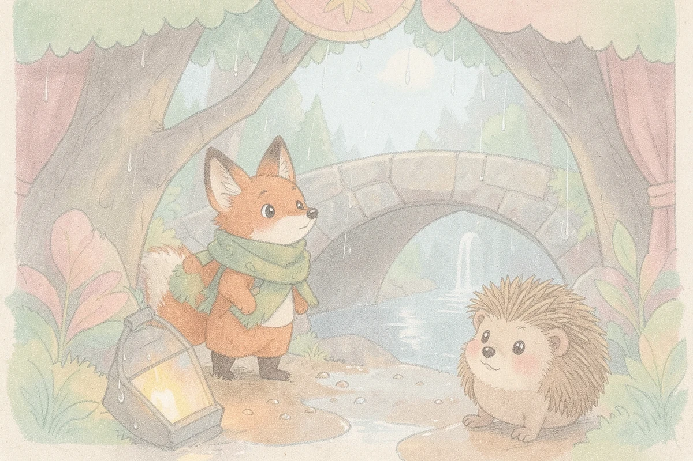
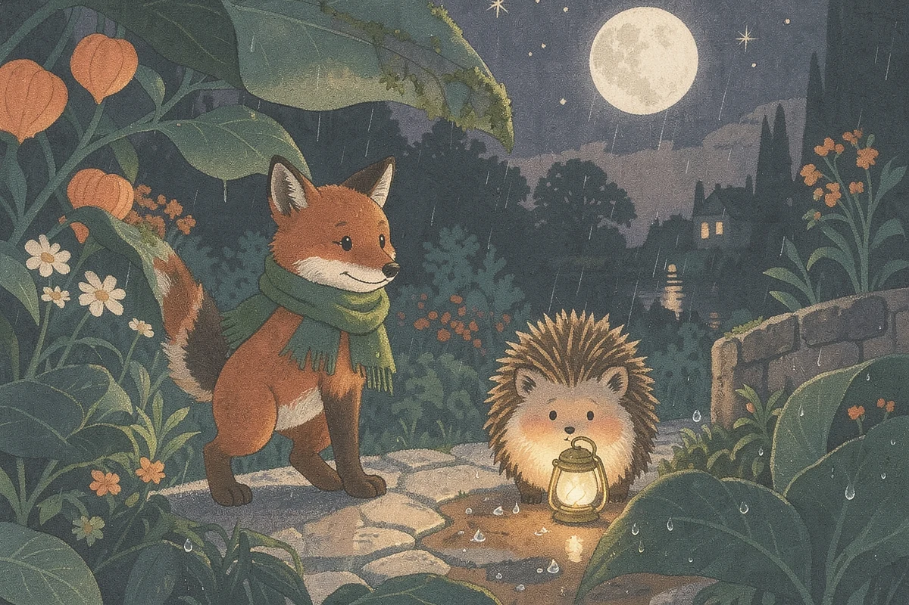

# The Lantern Under the Bridge

A four-page sample written with the configured groq text gateway. The first scene was rendered in both new art directions with the configured Cloudflare Workers AI image gateway, using each CyliaTales style board as a material reference.

## Page 1

After the rain, little fox Tavi finds a warm, brass lantern beneath the old woodland bridge.

## Page 2

Tavi meets shy hedgehog Moss, who whispers that the lantern belongs to the night gardener who tends the moonflowers.

## Page 3

Together they carry the lantern through the glowing meadow, placing it on the garden’s stone pedestal.

## Page 4

The night gardener thanks them, and the lantern’s light shines bright, lighting the garden for all forest friends.

## Narration check

[Listen to the live Cloudflare Aura-2 narration sample](narration-wren.mp3). This short English line was rendered through the new server-side Cloudflare fallback as a 4.13-second, mono 24 kHz MP3; automated transcription recovered the intended sentence in the [transcript](narration-transcript.txt). [Sanitized check details](narration-check.json).

## Style comparison

| Art direction | Illustration |
|---|---|
| Paper Theatre |  |
| Woodland Blockprint |  |

Generated 2026-10-30T01:51:35.905Z. These are local QA artifacts, not a book saved into an authenticated user's library.
